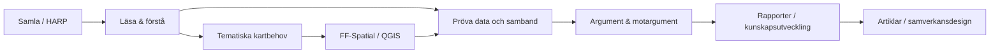

# Beredskap – arbetsdashboard
**Läsbar statusöversikt · uppdaterad 2026-11-20 · källor och process i separat register**

> **Arbetets identitet:** Kunskapsutveckling och fördjupning – inte ett formellt forskningsprojekt. Deep Research används för att stärka rapportunderlagen. **GitHub-tabellerna här är en verifierad ögonblicksbild, inte automatisk live-telemetri.**

## Överblick
| Källor | HARP RefA klara | Önskade datamängder | Prövbara argument | Milstolpsärenden | Heby-kartor verifierade |
|---:|---:|---:|---:|---:|---:|
| **177** | **0** | **20** | **15** | **9** | **0** |

**Nuvarande arbete:** MS0 – struktur, åtkomst, navigering och kontroll. MS1 – originalhandlingar, primärdata och aktörsdokumentation följer. **Inga HARP-klarerade belägg eller API-testresultat påstås.**

## Faser och väg till kunskapsprodukter

## De två fördjupningsdelarna
| Del | Frågeobjekt | Läsning | Status |
|---|---|---|---|
| **Del 1** | Naturhistoria, policy, data, scenarier, elcentralen och konsekvenskedjan | [Vilken kunskap rann förbi?](kunskap/HEBY_UNDER_YTAN.md) | Underlagsinsamling |
| **Del 2** | Civilsamhällets förutsättningar, deltagande, resurser, sociala nyttor, närhet och data | [Hur ser vi det som bara rinner på?](kunskap/CIVILSAMHALLET.md) | Underlagsinsamling |
| **QGIS** | Multinivåbild av Heby och Uppsala län med civilsamhälle, exponering och offentliga data | [Kartprogram](kunskap/KARTOR_OCH_GEOGRAFI.md) · [QGIS-gren](https://github.com/Motherpher/Beredskap/tree/spatial/qgis-heby-uppsala-v1) | Förbereds, API-test ej utfört |

## Milstolpar med faktiska arbetslänkar
| ID | Arbetsresultat | Ärende | Rapportstatus |
|---|---|---|---|
| MS0 | Källarkitektur, dokument, wiki, dashboard | [#2](https://github.com/Motherpher/Beredskap/issues/2) | Struktur under färdigställande |
| MS1 | Originaldata, källluckor, förfrågningar | [#3](https://github.com/Motherpher/Beredskap/issues/3) | Väntar på källsvar |
| MS2 | Historisk risk- och scenariobaslinje | [#4](https://github.com/Motherpher/Beredskap/issues/4) | Ej verifierad |
| MS3 | Elcentralens livshistoria, fyra dygn/timmar | [#5](https://github.com/Motherpher/Beredskap/issues/5) | Ej verifierad |
| MS4 | Kunskapsöverföring, beslut, alternativ | [#6](https://github.com/Motherpher/Beredskap/issues/6) | Ej verifierad |
| MS5 | Civilsamhällets kapacitet och insatser | [#7](https://github.com/Motherpher/Beredskap/issues/7) | Ej verifierad |
| MS6 | Citizen sensing, weak signals, scenarier | [#8](https://github.com/Motherpher/Beredskap/issues/8) | Ej verifierad |
| MS7 | Prövade argument, motargument och syntes | [#9](https://github.com/Motherpher/Beredskap/issues/9) | Ej verifierad |
| MS8 | Sakgranskade rapporter, artikelunderlag | [#10](https://github.com/Motherpher/Beredskap/issues/10) | Ej verifierad |

## Önskad data, funna spår och kunskapsluckor
**[Datakatalog i Markdown](kunskap/DATA_OCH_BELAGG.md)** · **[Argumentbank](kunskap/ARGUMENT_OCH_MOTPROVNING.md)** · **[HARP-källbibliotek](kallor/README.md)**

Prioriterade luckor: fullständiga RSA-årgångar, modellernas faktiska täckning av Örsundaån/Heby tätort, elcentralens historiska funktions- och åtgärdsbeslut, verifierad krislogg, aktiva föreningars geografiska verksamhet före 2023 och faktiska former för samverkan under krisen.

## Beslutspunkter
| Fråga | Vems beslut? | Status |
|---|---|---|
| Vilka data-API:er får anslutas och för vilka ändamål? | Director / leverantörens tillstånd | **Väntar – inga nycklar här** |
| Vilka kartlager kan offentliggöras utan integritets-/säkerhetsrisk? | Director + respektive datarättighet/sakkunnig | **Ej klarerat** |
| När kan ett påstående få publiceras? | RefA + redaktionell/sakkunnig kontroll | **Ej klart** |
| När aktiveras FFOS arbetsdispatch? | Separat auktoriserat integrationsbeslut | **Inte aktiverat** |

## Genomförande och uppföljning
[Roadmap](roadmap/MASTER_ROADMAP.md) · [GitHub-ärenden](https://github.com/Motherpher/Beredskap/issues) · [QGIS-gren](https://github.com/Motherpher/Beredskap/tree/spatial/qgis-heby-uppsala-v1) · [Alla Markdown-sidor](INDEX.md)

**Att denna dashboard är läsbar betyder inte att alla forsknings- och HARP-aktiviteter har slutförts.**
