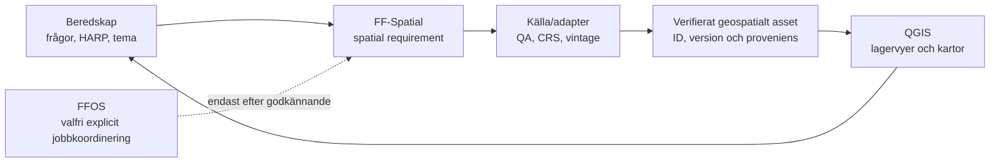

# Integration: Beredskap ↔ FF-Spatial ↔ FFOS

## Rättigheter och domänägarskap
1. **Director** godkänner API:er, källanvändning, analysändamål, externa körningar, publicering och aktivering.
2. **Beredskap** är kanoniskt för Hebys frågor, civilsamhällets koncept, databehov, publikationsprojekt, kartkrav och HARP-sakbelägg. Detta repo är en **konsument** av verifierade geografiska produkter.
3. **FF-Spatial** är kanoniskt för geografisk källdiscovery, source promotion, källadapter, geoasset-ID, geometri, CRS, versionsår, spatiala join-regler, GeoPackage och QGIS.
4. **FFOS** kan vara **operativt samordnande kontrollplan** men får inte förtiga att dess domänövergripande dispatch och långsiktig lagring är separata godkännandesteg. FFOS kan inte godkänna HARP-källor eller ändra GIS-sanningskälla.

## Underlag lästa i deras egna repo
- [FF-Spatial: arkitektur](https://github.com/Motherpher/FF-Spatial/blob/main/docs/ARCHITECTURE.md).
- [FF-Spatial: QGIS-integration](https://github.com/Motherpher/FF-Spatial/blob/main/qgis/README.md).
- [FF-Spatial: Source Promotion Gate](https://github.com/Motherpher/FF-Spatial/blob/main/docs/SOURCE_PROMOTION.md).
- [FF-Spatial: Spatial Requirement-schema](https://github.com/Motherpher/FF-Spatial/blob/main/registry/requirement.schema.json).
- [FF-Spatial: Spatial Product Manifest](https://github.com/Motherpher/FF-Spatial/blob/main/registry/spatial-product.schema.json).
- [FF-Spatial: QGIS Job-schema](https://github.com/Motherpher/FF-Spatial/blob/main/bridge/job.schema.json).
- [FF-Spatial: återanvändbara spatial assets](https://github.com/Motherpher/FF-Spatial/blob/main/docs/REUSABLE-SPATIAL-ASSET-AND-LAYER-GOVERNANCE-PROPOSED-v0.1.md) – **föreslagen**, inte slutligt antagen.
- [FFOS: synchronisation contract](https://github.com/Motherpher/FFOS/blob/main/docs/governance/github-estate/PROJECT-SYNCHRONISATION-CONTRACT-v1.md) – en **review candidate**, inte verifierad live cross-repo-sync.
- [FFOS: cloud-independent execution](https://github.com/Motherpher/FFOS/blob/main/docs/architecture/CLOUD-INDEPENDENT-EXECUTION-2026-11-16.md) – manuella piloter, inte accepterad produktion.
- [FFOS: optional DevOps discovery v1.1](https://github.com/Motherpher/FFOS/blob/main/docs/operations/devops/AMENDMENT-v1.1-OPTIONAL-DISCOVERY.md) – **OFFER_ONLY**; inga automatiska agent-/work-package-aktiveringar.

## Dataflöde – tänkt, inte live

## Konkret kontrakt
- Beredskap publicerar en **kandidatspatial requirement** enligt det faktiska FF-Spatial-schemat `registry/requirement.schema.json`.
- FF-Spatial ska i en separat godkänd arbetsorder fatta beslut: `REUSE_EXACT`, `REUSE_WITH_TRANSFORMATION`, `REFRESH_REQUIRED`, `NEW_SOURCE_REQUIRED`, `BLOCKED`. Dokumentet från 2026-11-16 beskriver denna modell som **föreslagen**.
- FF-Spatial skapar endast efter QA en produktmanifest med version, source_ids, geography/vintage/CRS, verifierade artifacts/checksums och process receipt. Inte före producerad kartdata.
- Beredskap tillför till den verifierade geodataprodukten **HARP-ID, sakanspråk, begrepp och analytisk användning**. Källens versionsinformation får inte försvinna.
- FFOS får endast en **föreslagen work-order-binding** efter uttryckligt beslut; en koppling till ett annat GitHub-repo är inte ett exekveringsbevis.

## Säkerhets- och anti-korruptionsregler
Ingen credential, rå persongeografi, kritisk VA/elteknisk detalj eller dold API-key i GitHub. Käll- eller schemaförändring i FF-Spatial måste föranleda ny kompatibilitetskontroll. Originaldata bevaras oförändrade i auktoriserad lagring, och GitHub-bifogade artifacts är inte utan vidare en långsiktig databas.

**Aktuellt läge:** kontrakt **förberett**; inga externa FF-Spatial- eller FFOS-ändringar har gjorts genom denna gren.
