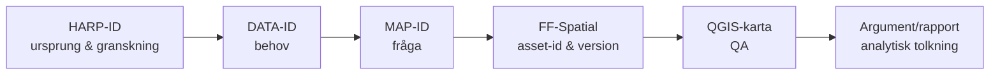

# Från HARP-källa till verifierad karttolkning

## Identifierarkarta
**HARP-källa** identifierar underlagets proveniens; **DATA-ID** beskriver vad kunskapsarbetet behöver; **MAP-ID** beskriver kartprodukten; **FF-Spatial source/asset-ID** beskriver geografiskt original och deriverad dataprodukt; **FFOS work order** beskriver eventuell framtida samordning.

## Obligatoriska kopplingar i ett framtida leveranskvitto
`harp_ids[]`, `data_requirement_ids[]`, `map_id`, `asset_id`, `asset_version_id`, `ff_spatial_job_id`, `source_ids[]`, `qa_receipt_uri`, `license_review`, `temporal_version`, `provenance_record`, `release_decision`.

### Krav på eventuella FFOS-händelser
Källans faktiska GitHub issue/PR eller work-order-ID behåller företräde framför eventuellt FFOS-projekts statusfält. Inga statusändringar görs automatiskt av en föreslagen extern uppdragskoppling.
